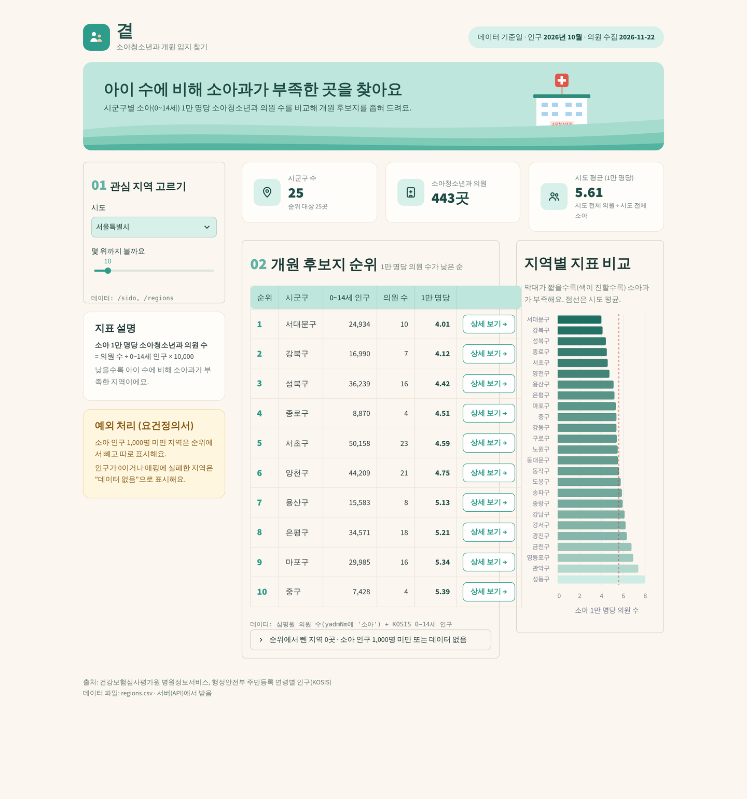
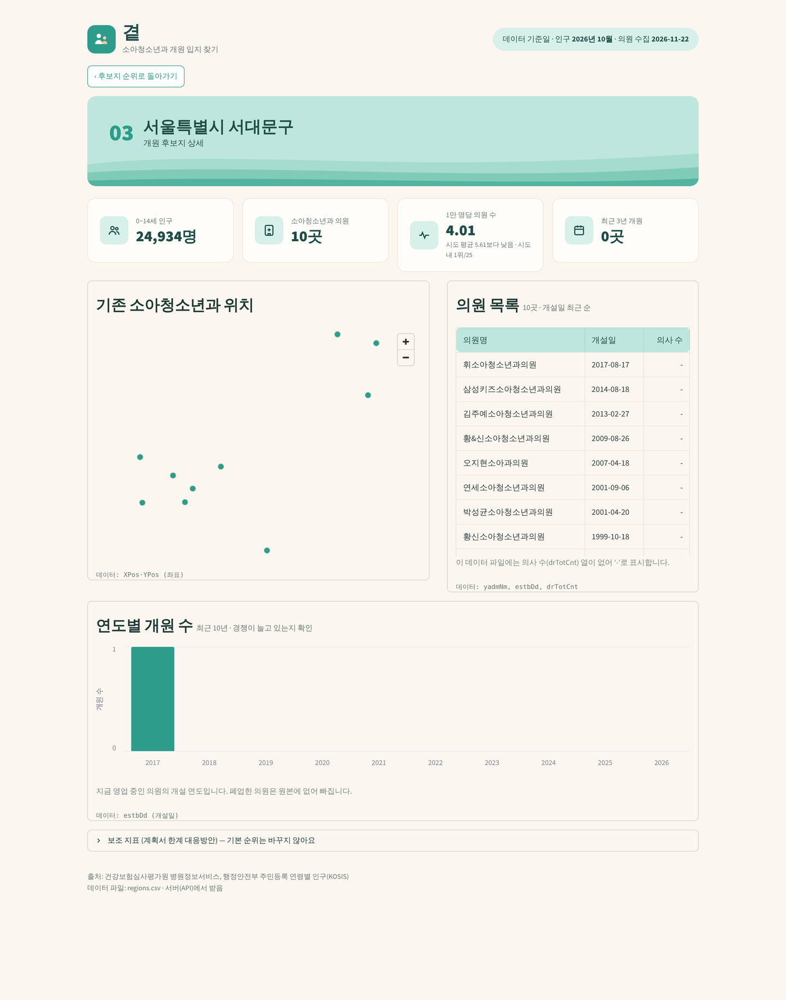

# 곁 — 소아청소년과 개원 입지 데이터 서비스

> 소아청소년과 의원을 연다면, 아이 수에 비해 소아과가 부족한 시군구는 어디인가?

시군구별 소아(0~14세) 인구 1만 명당 소아청소년과 의원 수를 계산해, 개원 후보 지역을 좁혀 주는 서비스입니다.

## 화면

| 메인 (개원 후보지 순위) | 상세 (시군구 하나) |
|---|---|
|  |  |

- 화면 위쪽에 **데이터 기준일**(인구 기준월, 심평원 수집일)이 `/meta` 값 그대로 표시됩니다.
- 순위표의 `상세 보기 →` 를 누르면 그 시군구의 의원 목록·위치·연도별 개원 수가 나옵니다.
- 지도는 인터넷에 연결돼 있어야 배경 지도가 보입니다. 연결이 막혀 있으면 점만 보입니다.

## 설치와 실행

인증키(.env)와 서버가 없어도 `data/sample/` 의 서울 샘플로 바로 실행됩니다.

1. 저장소 받기: `git clone https://github.com/Ahyeon1223/geot-pediatric-site.git && cd geot-pediatric-site`
2. 패키지 설치: `pip install -r requirements.txt`
3. 화면 실행: `streamlit run app.py` → 브라우저에서 http://localhost:8501

   이때 화면은 서버가 꺼져 있으면 `src/api.py` 의 계산 함수를 직접 불러 씁니다.

### 서버까지 같이 띄우기 (원래 구조대로)

```bash
uvicorn src.api:app --reload      # 창 1: 서버 (http://127.0.0.1:8000/docs)
streamlit run app.py              # 창 2: 화면 → 서버에서 JSON을 받아 그림
```

화면 맨 아래에 "서버(API)에서 받음 / 서버 없이 데이터 파일을 직접 읽음" 중 어느 쪽인지 표시됩니다.
서버 주소가 다르면 `GEOT_API_URL=http://내주소:8000 streamlit run app.py` 처럼 지정합니다.

### 전국 데이터로 실행하기 (인증키 필요)

1. `.env.example` 을 복사해 `.env` 로 바꾸고 공공데이터포털 인증키 입력
2. `python src/collect.py` → `python src/clean.py`
   - `data/processed/regions.csv` 가 생기면 화면과 서버가 샘플 대신 그 파일을 씁니다.
3. 샘플을 다시 만들려면 `python src/make_sample.py` (기본: 서울)

### 테스트

```bash
python -m pytest tests
```

`tests/test_sample.py` 는 샘플 데이터 화면 값이 건수 검증표와 같은지 확인합니다
(1위 서대문구 10 ÷ 24,934 × 10,000 = 4.01, 종로구 4 ÷ 8,870 × 10,000 = 4.51).

## 사용한 데이터

| 구분 | 데이터 | 받는 방법 |
|---|---|---|
| 수집 (API) | 건강보험심사평가원 병원정보서비스 | 공공데이터포털 Open API |
| 결합 | 행정안전부 주민등록 연령별 인구 (시군구) | KOSIS |
| 매핑 | 행정표준코드 (시군구) | 행정표준코드관리시스템 |

## 폴더 구조

```
├── app.py              Streamlit 화면 (메인 순위 + 시군구 상세)
├── src/
│   ├── collect.py      공공 API 수집
│   ├── clean.py        정리·결합, 건수 검증표 생성
│   ├── api.py          FastAPI 서버
│   └── test_hira_api.py  심평원 API 시험 호출
├── data/
│   ├── raw/            원본 (GitHub에 올리지 않음)
│   └── sample/         인증키 없이 실행할 때 쓰는 샘플
├── docs/
│   ├── 요구사항.md      의사결정 질문, 입력·출력·예외
│   └── prompts.md      AI에게 준 프롬프트와 고친 과정
├── reports/
│   └── count_check.md  건수 검증표
└── tests/              테스트
```

## 역할

| 역할 | 담당 | 맡은 일 |
|---|---|---|
| 데이터 | 김재헌 | collect.py, clean.py, 매핑표, 건수 검증표 |
| 서버 | 고우영 | FastAPI 엔드포인트, 예외 처리, 테스트 |
| 화면 | 김아현 | Streamlit 화면, README, 샘플 데이터 실행 |

## 경영적 시사점과 한계

> 작성 예정
